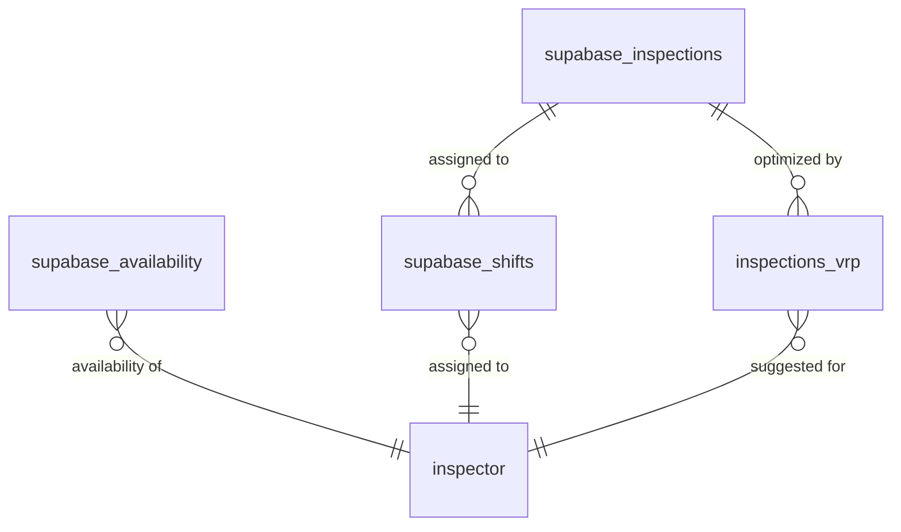

# Data Model (Postgres / Supabase)

## Database Schema

### Tables

#### `supabase_inspections`
```sql
CREATE TABLE supabase_inspections (
  id UUID PRIMARY KEY DEFAULT gen_random_uuid(),
  address TEXT NOT NULL,
  type TEXT NOT NULL CHECK (type IN ('Proforma', 'Projektsyn', 'Indflytningssyn', 'Fraflytningssyn')),
  date_local DATE NOT NULL,
  department TEXT NOT NULL,
  status TEXT NOT NULL DEFAULT 'UNSCHEDULED' CHECK (status IN ('UNSCHEDULED', 'SCHEDULED', 'CANCELLED')),
  created_at TIMESTAMP WITH TIME ZONE DEFAULT NOW(),
  updated_at TIMESTAMP WITH TIME ZONE DEFAULT NOW()
);
```

#### `supabase_availability`
```sql
CREATE TABLE supabase_availability (
  id UUID PRIMARY KEY DEFAULT gen_random_uuid(),
  inspector_id UUID NOT NULL,
  inspector_name TEXT NOT NULL,
  date_local DATE NOT NULL,
  is_available BOOLEAN NOT NULL DEFAULT false,
  source TEXT,
  fetched_at TIMESTAMP WITH TIME ZONE DEFAULT NOW(),
  raw_payload JSONB
);
```

#### `supabase_shifts`
```sql
CREATE TABLE supabase_shifts (
  id UUID PRIMARY KEY DEFAULT gen_random_uuid(),
  inspection_id UUID REFERENCES supabase_inspections(id),
  inspector_id UUID NOT NULL,
  inspector_name TEXT NOT NULL,
  date_local DATE NOT NULL,
  department TEXT NOT NULL,
  type TEXT NOT NULL,
  status TEXT NOT NULL DEFAULT 'ASSIGNED' CHECK (status IN ('ASSIGNED', 'DONE', 'CANCELLED')),
  created_at TIMESTAMP WITH TIME ZONE DEFAULT NOW()
);
```

#### `inspections_vrp`
```sql
CREATE TABLE inspections_vrp (
  id UUID PRIMARY KEY DEFAULT gen_random_uuid(),
  run_id UUID NOT NULL,
  inspection_id UUID REFERENCES supabase_inspections(id),
  inspector_id UUID NOT NULL,
  inspector_name TEXT NOT NULL,
  score DECIMAL(10,4),
  created_at TIMESTAMP WITH TIME ZONE DEFAULT NOW()
);
```

## Indexes

### Performance Optimization
```sql
-- Inspections by status, department, and date
CREATE INDEX idx_inspections_status_dept_date ON supabase_inspections(status, department, date_local);

-- Availability by inspector and date
CREATE INDEX idx_availability_inspector_date ON supabase_availability(inspector_id, date_local);

-- Shifts by inspection and inspector
CREATE INDEX idx_shifts_inspection_inspector ON supabase_shifts(inspection_id, inspector_id);

-- VRP suggestions by run and score
CREATE INDEX idx_vrp_run_score ON inspections_vrp(run_id, score DESC);
```

## Row Level Security (RLS) Policies

### Inspections Table
```sql
-- Enable RLS
ALTER TABLE supabase_inspections ENABLE ROW LEVEL SECURITY;

-- Read all UNSCHEDULED inspections
CREATE POLICY "Read unscheduled inspections" ON supabase_inspections
  FOR SELECT USING (status = 'UNSCHEDULED');

-- Update only for admin/scheduler roles
CREATE POLICY "Update inspections for schedulers" ON supabase_inspections
  FOR UPDATE USING (
    auth.jwt() ->> 'role' IN ('admin', 'scheduler')
  );
```

### Availability Table
```sql
-- Enable RLS
ALTER TABLE supabase_availability ENABLE ROW LEVEL SECURITY;

-- Read all availability data
CREATE POLICY "Read all availability" ON supabase_availability
  FOR SELECT USING (true);

-- Insert/Update restricted to scheduler roles
CREATE POLICY "Modify availability for schedulers" ON supabase_availability
  FOR ALL USING (
    auth.jwt() ->> 'role' IN ('admin', 'scheduler')
  );
```

### Shifts and VRP Tables
```sql
-- Enable RLS for shifts
ALTER TABLE supabase_shifts ENABLE ROW LEVEL SECURITY;

-- Read-only access for now
CREATE POLICY "Read shifts" ON supabase_shifts
  FOR SELECT USING (true);

-- Enable RLS for VRP
ALTER TABLE inspections_vrp ENABLE ROW LEVEL SECURITY;

-- Read-only access for now
CREATE POLICY "Read VRP suggestions" ON inspections_vrp
  FOR SELECT USING (true);
```

## Data Relationships



## Data Validation Rules

- **Inspection Types**: Must be one of the four predefined Danish inspection types
- **Status Transitions**: UNSCHEDULED → SCHEDULED → DONE/CANCELLED
- **Date Constraints**: All dates must be future dates for new inspections
- **Department**: Must match predefined department list
- **Availability**: Inspector must exist before availability can be set