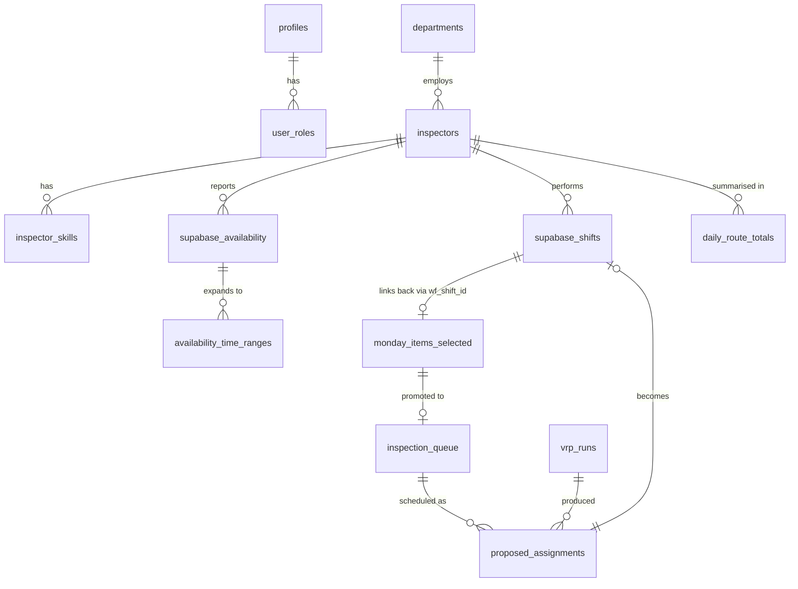

# Data Model — Ruteplanlægger (Supabase)

Authoritative reference for the Postgres schema that backs Ruteplanlægger and the
integrations with **Monday.com** (inspection source of truth) and **WorkFeed**
(roster, availability, and shift execution). Source of truth for SQL is
`supabase/migrations/`; this document explains the *why* and the *flow*.

---

## 1. Overview

The platform schedules property inspections in Denmark. Three external systems
meet in Supabase:

| System         | Direction         | What it owns                              |
| -------------- | ----------------- | ----------------------------------------- |
| Monday.com     | Inbound           | Inspection jobs (customer, address, type) |
| WorkFeed       | Inbound + outbound| Inspector roster, availability, shifts    |
| Railway VRP API| Inbound + outbound| Route optimisation                        |
| Mapbox         | Inbound (cached)  | Geocoding + travel-time matrix            |
| Twilio         | Outbound          | SMS reminders                             |

Supabase holds the canonical scheduling state and orchestrates everything via
edge functions and a small set of cron jobs.

---

## 2. Conventions

- **Primary keys** are `uuid` (`gen_random_uuid()`) except `monday_items_selected.id`
  which is a `bigint` matching Monday's item id.
- **Timestamps**: every domain table has `created_at` / `updated_at` defaulting
  to `now()`. Domain-relevant times always come in two flavours when crossing
  the WorkFeed boundary: `*_utc` (timestamptz) and `*_local` (time, Europe/Copenhagen).
  Conversion is done with a dynamic DST offset — never hardcoded.
- **Soft delete**: `inspectors.is_active` and `departments.is_active`. Hard delete
  is avoided to preserve historical shift integrity.
- **`sync_status` pattern** (used by `supabase_shifts`): `pending → synced` or
  `pending → sync_failed`, with `sync_error`, `sync_attempts`, `last_sync_attempt`.
- **Geocoding** always flows through `mapbox_coords_cache`. Edge functions look
  up the normalised address there before calling Mapbox.
- **RLS**: the project is an *internal* tool, so most operational tables expose
  authenticated read/write. Privilege-sensitive tables (`profiles`, `user_roles`,
  duration tables) gate writes through the `has_role(uid, 'admin')` SECURITY
  DEFINER function.

---

## 3. Auth & Access Control

### `profiles`
Mirror of `auth.users` populated by the `handle_new_user()` trigger.
- `id uuid` — equals `auth.users.id`
- `email`, `full_name`
- RLS: users read/update their own row; admins read all.

### `user_roles` + `app_role` enum
Role assignments stored *outside* `profiles` to prevent privilege-escalation
attacks via profile updates.
- `app_role` enum: `'admin' | 'user'` (extensible).
- `user_roles(user_id, role, granted_by, granted_at)` with unique `(user_id, role)`.
- Authorisation is checked via `public.has_role(_user_id, _role)` — SECURITY
  DEFINER, `STABLE`, scoped `search_path = public`. Used inside RLS policies and
  inside `promote_user` / `demote_admin` RPCs.
- Admin creation goes through the `admin-create-user` edge function (no email
  verification — internal tool).

---

## 4. Reference / Configuration tables

### `departments`
The Danish regional offices used to scope filters and roster views.
- `name`, `region`, `wf_department_id` (link to WorkFeed), `is_active`.

### `afdeling_to_department`
Maps the Danish "afdeling" labels used in Monday board filters to canonical
department names. Read-only public.

### `afdeling_zip`
Pre-built zip → afdeling lookup. Used to assign inbound Monday items to a
region when only an address is known.

### `inspection_type_mappings`
Maps the Danish full type name (e.g. `Indflytningssyn`) to its short
`abbreviation` (e.g. `IF`). Used by `get_wf_role_id_for_inspection()`.

### `role_mappings`
Maps WorkFeed `roleID` (`wf_role_id`) to the abbreviation. Joined with
`inspection_type_mappings` to resolve "inspection type → WorkFeed role id"
for outbound shift creation.

### `inspection_durations`
Base duration matrix: `(inspection_type enum, rooms int) → minutes`.
- Admin-only writes (`has_role('admin')`).
- See `mem://admin/inspection-duration-rules` for the canonical numbers.

### `inspection_duration_modifiers`
Additive modifiers (`+5m` for DYMO, `+10m` for Cylinderskift, etc.) with an
`applies_to text[]` filter listing the inspection types the modifier applies to.
- Manual `duration_minutes` overrides (see `monday_items_selected`) bypass
  modifiers entirely — see `mem://features/planlaeg-syn-duration-integration`.

---

## 5. Inspector domain

### `inspectors`
WorkFeed is the source of truth (memory rule). Rows are upserted by
`sync-workfeed-inspectors` keyed on `wf_employee_id`.
- Identity: `full_name`, `first_name`, `email`, `phone`.
- Geo: `address`, `lat`, `lng`, `geocode_status`, `geocode_error`. Geocoded by
  `geocode-inspector`.
- Org: `department_id → departments.id`.
- WorkFeed link: `wf_employee_id` (unique, non-null after sync).
- Lifecycle: `is_active` (soft delete — `mem://features/inspectors-soft-delete`).
- `notes` is used to flag TEST USERS during the TEST_MODE rollout (see
  `docs/workfeed-sync-implementation.md`).

### `inspector_skills`
Per-inspector capability list (`inspector_id`, `inspection_type`, `is_active`).
Joined into `get_vrp_input` to constrain which jobs each inspector can take.

### `supabase_availability`
One row per `(inspector_id, date_local)` representing what WorkFeed (or a manual
override) reports for that day.
- `is_available boolean`, `availability_status text` (`AVAILABLE` / `NOT_AVAILABLE`
  / `NO_RESPONSE` — populated by `get_availability_overview`).
- `source text`: `'workfeed'` for synced rows, `'override'` for manual edits.
  RLS allows authenticated INSERT/UPDATE only when `source = 'override'`.
- `start_time_local`, `end_time_local`: aggregated min/max from
  `availability_time_ranges`. **NULL means use the 08:00–16:00 fallback in VRP**
  (`mem://features/availability-time-handling`).
- `wf_availability_id`, `wf_type`, `raw_payload jsonb`: traceability back to WF.
- Window: synced 60 days ahead (`mem://features/availability-sync-window`).

### `availability_time_ranges`
Multiple ranges per availability row, so an inspector can be available
08–12 and 14–17 the same day. Aggregated up to `supabase_availability` start/end
by `set_consultant_availability_with_ranges()` so the VRP solver and capacity
view can read a single pair of times.

---

## 6. Inspection / Job domain

### `monday_items_selected` — **Monday source of truth**
Row per inspection ingested from a Monday board.
- Identity: `id bigint` = Monday's item id; `item_id`, `board_id`.
- Parsed payload: `Kunde`, `synstype`, `adresse`, `dato_tid` (the Monday-supplied
  timestamp — **never used for scheduling**, only for display, per
  `mem://core`), `lejemalsnr`, `antal_vaerelser`, `landsdel`, `region`, `note`.
- Raw payload: `raw jsonb` for full traceability.
- Trigger-derived flags: `has_dymo`, `has_cylinderskift`, set by
  `extract_inspection_flags` on every INSERT/UPDATE by scanning the note text.
- Scheduling state: `schedule_status`, `scheduled_inspector_id`,
  `scheduled_inspector_name`, `scheduled_start_time`, `scheduled_end_time`,
  `scheduled_date`, `scheduled_at`, `scheduled_by`, `wf_shift_id`.
- Route metadata written by VRP: `route_km`, `route_travel_minutes`, `route_sequence`.
- Manual override: `duration_minutes` (user-edited) takes absolute priority over
  the `inspection_durations` matrix (`mem://features/alle-syn-management`).
- Geocode: `lat`, `lng`, `geocode_status`. A Supabase DB webhook on INSERT calls
  `geocode-monday-items` (`mem://features/planlaeg-syn-auto-geocoding-on-insert`).
- RLS is open (internal tool with service-role sync clients).

### `inspection_queue`
The VRP-facing projection of a Monday item once it enters planning.
- Mirrors address/type/rooms/preferred_date/department from
  `monday_items_selected` plus `monday_item_id` back-reference.
- `status` lifecycle: `PENDING → IN_VRP → SCHEDULED`.
- `planned_by`, `planned_at` for audit.
- `lat`, `lng`, `geocode_status` for the solver.
- RLS: authenticated read/insert; update limited to the planner or an admin.

### `supabase_inspections` *(legacy)*
Earlier flat mirror (address/type/date_local/department/status). Kept for
legacy reads; new code writes to `monday_items_selected` + `inspection_queue`.

### `vrp_runs`
One row per optimisation invocation.
- `inspection_ids uuid[]`, `target_dates date[]`: inputs.
- `solution_json jsonb`: full Railway response.
- Metrics: `num_inspections_scheduled`, `total_travel_minutes`, `total_travel_km`,
  `execution_seconds`.
- `status`, `requested_by`, `triggered_by`, `reviewed_by`, `approved_at`.
- `ai_explanation`: free-text rationale (used by ProfSyn AI).

### `proposed_assignments`
Per-inspection rows produced by a VRP run. Survives review/approval and becomes
the authoritative schedule.
- `vrp_run_id → vrp_runs.id`, `inspection_id`, `inspector_id`.
- `scheduled_date`, `start_time`, `end_time`, `sequence_in_route`,
  `travel_from_previous_mins`.
- `assignment_source`: `'auto'` (from VRP) or `'manual'` (edited via
  `reassign_inspector_manual` RPC). `manual_override_at`, `manual_override_by`
  audit the change.
- `inspector_route_km` and `inspector_total_route_km`: the **full round-trip**
  distance for that inspector that day (already includes home leg —
  `mem://features/vrp-inspector-route-distance-complete`).

### `inspections_vrp` *(legacy ranking table)*
Stored per-suggestion score from earlier VRP iterations. Currently read-only and
not part of the live approval path.

### `supabase_shifts` — **WorkFeed mirror + outbound sync state**
Single table that represents both:
(a) inbound shifts pulled from WorkFeed by `sync-workfeed-shifts`, and
(b) outbound shifts created from approved VRP assignments.
- WorkFeed link: `wf_shift_id` (unique), `wf_employee_id`, `wf_role_id`.
- Inspector: `inspector_id → inspectors.id`, `inspector_name` (denormalised).
- Time: `start_utc`, `end_utc`, plus Copenhagen-local `start_time_local`,
  `end_time_local`, `duration_minutes`, `date_local`.
- Geo: `address`, `lat`, `lng` (geocoded during sync via `mapbox_coords_cache`).
- Route metadata: `route_km`, `route_travel_minutes`, `route_sequence`.
- Link back: `inspection_queue_id`, `inspection_id`.
- Outbound sync: `sync_status ∈ {pending, synced, sync_failed}`, `sync_error`,
  `sync_attempts`, `last_sync_attempt`.
- Sync window: 90 days ahead, **clean-slate** delete+reinsert per window.

### `daily_route_totals`
Per-`(inspector_id, route_date)` materialisation of route totals after a VRP
run is approved: `total_route_km`, `inspections_km`, `return_home_km`,
`includes_return_home`, `total_travel_minutes`, `inspection_count`,
`last_stop_address/lat/lng`. Backs the inspector route overview UI.

---

## 7. Caching & infrastructure

### `mapbox_coords_cache`
`normalized_address text PK → (lat, lon, updated_at)`. Every geocoding edge
function (`geocode-monday-items`, `geocode-inspector`, `sync-workfeed-shifts`,
`geocode-addresses`) checks this first to avoid Mapbox cost.

### `mapbox_travel_cache`
Pairwise travel-time/distance cache, populated by `cache-travel-times` before
VRP runs. Mandatory call before `preview-routes`
(`mem://features/route-optimizer-travel-time-accuracy`).

### `job_queue`
Generic async job table: `job_type`, `status`, `params jsonb`, `result jsonb`,
`error`, `started_at`, `completed_at`. Cleaned by `cleanup_old_jobs(hours)`.

### `worker_keepalive_log`
Keepalive ping log written by `ping_vrp_worker()` (pg_net → Railway `/ping`).
Auto-trimmed to last 100 rows.

---

## 8. Communication

### `sms_reminder_logs`
One row per SMS dispatched by `send-sms-reminder` (Twilio, +45 numbers only —
`mem://features/sms-reminder-system`).
- `batch_id` (multi-recipient batches), `inspector_id`, `phone`, `target_date`,
  `status`, `failure_reason`, `message_preview`, `sent_by`, `sent_at`.
- Display formatting excludes year (`mem://features/sms-reminder-date-format`).

---

## 9. Database functions & triggers

| Object                                         | Type                | Purpose                                                                                      |
| ---------------------------------------------- | ------------------- | -------------------------------------------------------------------------------------------- |
| `has_role(uid, app_role)`                      | SECURITY DEFINER fn | Single source of truth for role checks inside RLS                                            |
| `handle_new_user()`                            | trigger fn          | On `auth.users` insert: create `profiles` row + default `user` role                          |
| `extract_inspection_flags()`                   | trigger fn          | On `monday_items_selected` insert/update: set `has_dymo`, `has_cylinderskift`                |
| `trigger_geocode_monday_items()`               | trigger fn          | `pg_net.http_post` to `geocode-monday-items` for new Monday rows                             |
| `promote_user(email)` / `demote_admin(email)`  | SECURITY DEFINER fn | Admin-only role grant/revoke                                                                 |
| `set_consultant_availability(...)`             | SECURITY DEFINER fn | Upsert a simple availability row (legacy path)                                               |
| `set_consultant_availability_with_ranges(...)` | SECURITY DEFINER fn | Upsert availability + N time ranges, aggregating min/max to the parent row                   |
| `get_availability_overview(dates[])`           | STABLE fn           | Cartesian product of active inspectors × dates with NO_RESPONSE fallback for missing rows    |
| `get_availability_summary(dates[])`            | STABLE fn           | Per-date counters + response rate                                                            |
| `get_vrp_input(inspection_ids[], dates[])`     | plpgsql fn          | Builds the full Railway payload: inspections + inspectors + capacity + existing shifts       |
| `get_wf_role_id_for_inspection(type)`          | plpgsql fn          | Resolves inspection type → abbreviation → WorkFeed `wf_role_id`                              |
| `save_vrp_solution(...)`                       | plpgsql fn          | Persists a VRP run + assignments and flips inspections to `IN_VRP`                           |
| `reassign_inspector_manual(...)`               | SECURITY DEFINER fn | Manual inspector swap with audit (`assignment_source='manual'`, `manual_override_at/by`)     |
| `cleanup_old_jobs(hours)`                      | SECURITY DEFINER fn | Removes terminal `job_queue` rows                                                             |
| `ping_vrp_worker()`                            | plpgsql fn          | pg_net ping to Railway keepalive endpoint                                                    |
| `update_updated_at_column()`                   | trigger fn          | Generic `updated_at = now()` trigger                                                          |

There are currently **no enabled triggers** on application tables besides the
ones documented above and the `update_updated_at_column` triggers per table.
The geocode and `extract_inspection_flags` invocations happen via trigger
functions wired in their respective migrations.

---

## 10. Data Flows

### 10.1 Monday.com → Platform

Monday is the **inbound source of truth for inspections**. The Lovable app
never creates Monday items; it only consumes and annotates them.

```text
Monday board change
  └─► Monday webhook  (configured outside Supabase)
        └─► INSERT/UPSERT into public.monday_items_selected
              ├─► trigger extract_inspection_flags()
              │     └─► sets has_dymo, has_cylinderskift from note text
              └─► trigger trigger_geocode_monday_items()
                    └─► pg_net.http_post → edge: geocode-monday-items
                          ├─► normalise address
                          ├─► look up mapbox_coords_cache
                          ├─► (miss) call Mapbox → upsert cache
                          └─► UPDATE monday_items_selected SET lat, lng, geocode_status
```

Downstream:
- `/alle-syn` reads `monday_items_selected` directly with sort/filter/pagination.
- When the planner selects items in `/planlaeg-syn`, the chosen rows are projected
  into `inspection_queue` (status `PENDING`) so the VRP solver has a stable
  surface to work on. The `monday_item_id` back-reference keeps them linked.
- The `note` field has special precedence rules: a user-edited value beats the
  raw Monday note (`mem://features/workfeed-note-prioritization`).

### 10.2 WorkFeed → Platform

Three independent inbound flows, all triggered by Supabase cron jobs and
manually invokable via the admin UI.

**Inspectors** — `sync-workfeed-inspectors`, scheduled by `sync-inspectors-cron`.
Upserts `inspectors` rows keyed on `wf_employee_id`. Soft-delete preserved
(`is_active = false` rather than `DELETE`).

**Availability** — `workfeed-ingest-availability` and `sync-availability-cron`.
Writes `supabase_availability` (and N `availability_time_ranges` rows) for a
60-day forward window. Rows are tagged `source = 'workfeed'`; manual overrides
go through `set_consultant_availability_with_ranges` and are tagged `'override'`,
which is the only `source` value an authenticated user is allowed to write via RLS.

**Shifts** — `sync-workfeed-shifts`, scheduled by `sync-shifts-cron`.

```text
Cron tick (or manual button)
  └─► sync-workfeed-shifts(startDate=today, endDate=today+90d)
        ├─► load mappings: inspectors (wf_employee_id), departments, role_mappings
        ├─► GET https://europe-west1-…/companies/{id}/shifts?startFrom&startTo
        ├─► DELETE supabase_shifts WHERE date_local BETWEEN startDate AND endDate
        │       (clean-slate to handle Workfeed deletions/reshuffles)
        ├─► for each WorkFeed shift:
        │     ├─► resolve inspector via wf_employee_id (skip unmapped)
        │     ├─► convert start/end UTC → Copenhagen local (DST-aware)
        │     ├─► extract address from comment.message first line
        │     ├─► geocode address via mapbox_coords_cache
        │     └─► INSERT supabase_shifts (sync_status not set here — these are inbound)
        └─► return { synced, unmapped, errors, geocoded }
```

### 10.3 Platform → WorkFeed

There are two outbound paths into WorkFeed.

**A. VRP approval path** — the main "Godkend syn" button:

```text
User clicks "Godkend syn" in PlanlaegSynModal
  └─► edge: approve-vrp-assignments
        ├─► INSERT vrp_runs row (status='COMPLETED')
        ├─► INSERT proposed_assignments rows (one per inspection)
        ├─► INSERT supabase_shifts rows (sync_status='pending')
        ├─► UPDATE inspection_queue.status = 'SCHEDULED'
        └─► return { vrp_run_id, shift_ids[] }

Frontend then iterates shift_ids and invokes:
  edge: post-to-workfeed(shiftId)
        ├─► load shift + inspector
        ├─► resolve WF role via get_wf_role_id_for_inspection(inspection_type)
        ├─► convert Copenhagen local → UTC with dynamic DST offset
        ├─► POST https://europe-west1-…/companies/{id}/shifts
        ├─► on success: UPDATE supabase_shifts SET wf_shift_id, sync_status='synced'
        └─► on failure: UPDATE sync_status='sync_failed', sync_error=…, ++sync_attempts

After all shifts processed:
  edge: update-monday-after-workfeed
        └─► PATCH Monday items with scheduled_date/start/end/inspector + wf_shift_id
              (all dates UTC, dynamic DST offset — mem://infrastructure/external-api-timezone-handling)
```

TEST_MODE (`src/lib/testMode.ts`) gates this path so only the three test
inspectors receive shifts during rollout — see
`docs/workfeed-sync-implementation.md`.

**B. Manual shift path** — `send-manual-shifts-to-workfeed`:

Same downstream contract as `post-to-workfeed` but originates from a user
manually building a shift in the UI without going through VRP. Useful for
one-off jobs or corrections.

### 10.4 VRP optimisation loop

```text
User clicks "Beregn" in /planlaeg-syn
  └─► edge: cache-travel-times (must run first — mem rule)
  └─► edge: compute-vrp-routes
        ├─► CALL get_vrp_input(inspection_ids, target_dates)
        │       → JSON { inspections, inspectors, inspector_capacity, existing_shifts }
        ├─► POST https://profsyn-vrp-api-production.up.railway.app/optimize
        ├─► poll job status (timeout + collision handling — mem://features/vrp-system-architecture)
        ├─► CALL save_vrp_solution(...)
        │       → INSERT vrp_runs + proposed_assignments, UPDATE inspection_queue=IN_VRP
        └─► return route plan grouped by inspector
```

The frontend renders the proposal in `PlanlaegSynModal`, allows inline
inspector swaps (`reassign_inspector_manual`) and time edits, and finally
kicks off the approval flow in §10.3.

---

## 11. ER diagram (core scheduling graph)



See `/mnt/documents/data-flows.mmd` for the cross-system flow diagram bundled
with this doc.